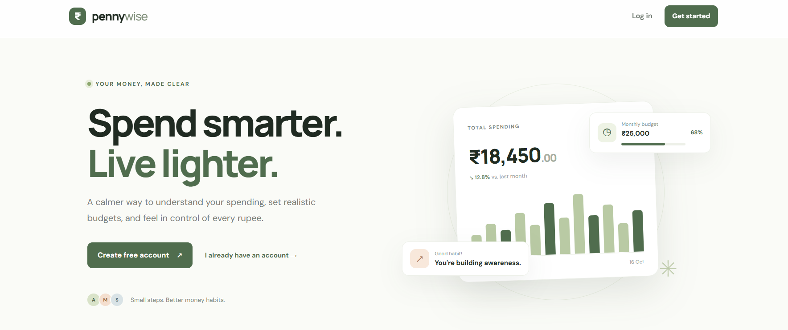
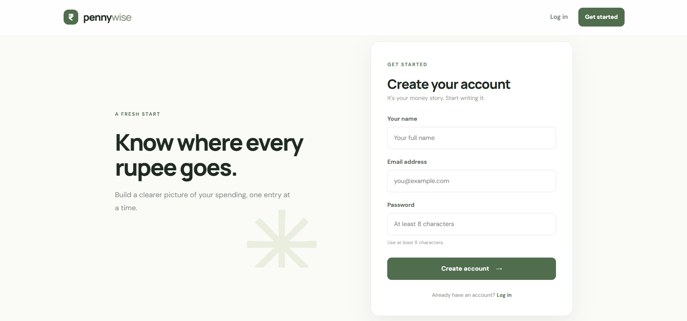
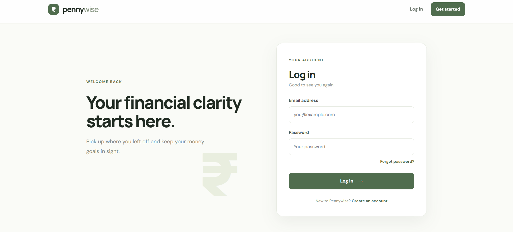
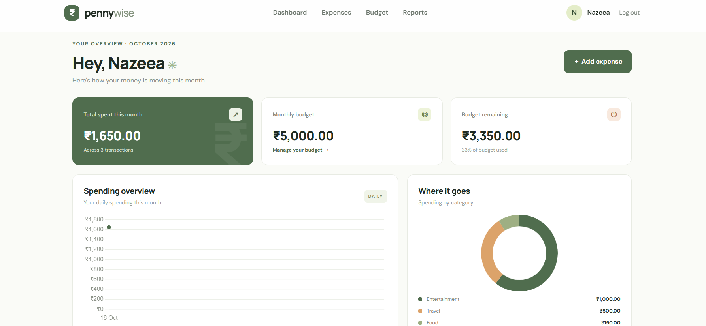
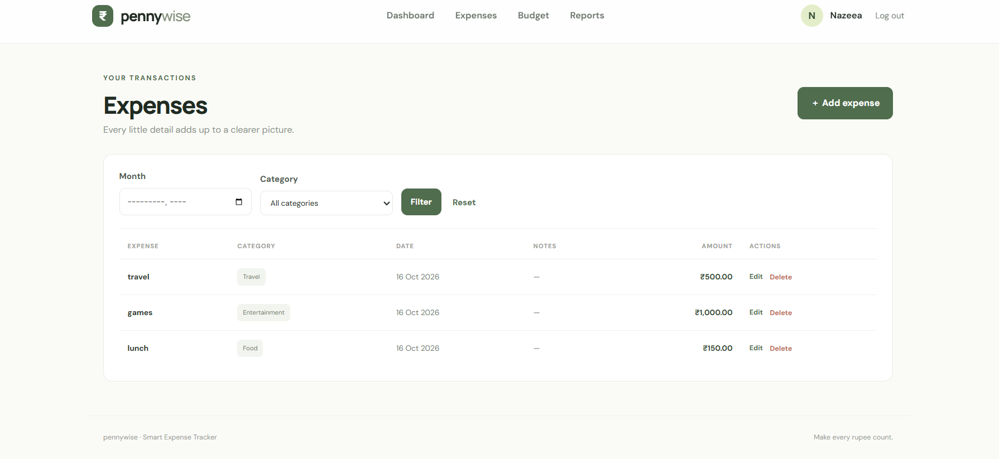
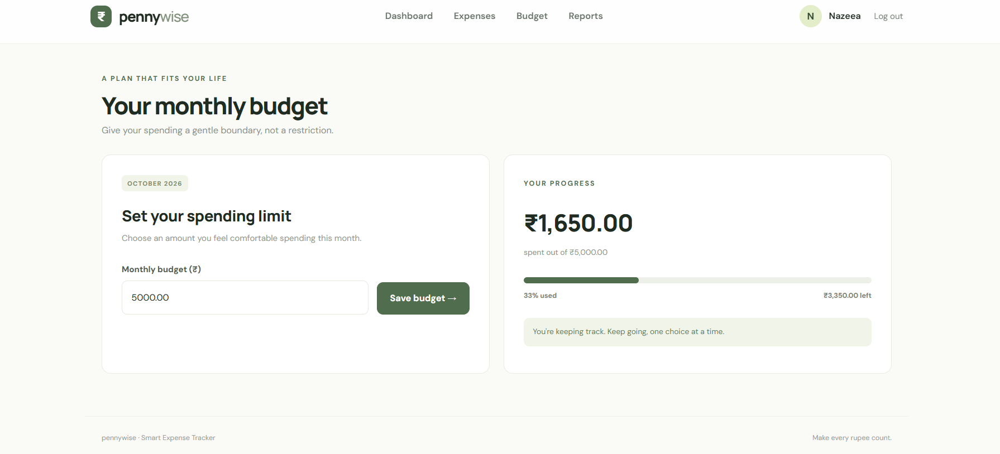

# Smart Expense Tracker

A full-stack expense tracking web application built with **Python Flask, MySQL, HTML, CSS and Chart.js**.

## Features

- User registration and login with hashed passwords
- Forgot password: emailed reset link that expires in 15 minutes and works only once
- Dashboard showing current-month spending, transaction count and budget status
- Add, edit and delete personal expenses
- Expense category and month filters
- Monthly budget setting and progress indicator
- Date-range report with CSV download in the browser
- Category doughnut chart and daily spending chart
- Responsive layout for desktop and mobile
- Each user's expenses are scoped to their own account
- Parameterized SQL queries for database operations

## Requirements

- Python 3.10 or newer
- MySQL Server running locally
- VS Code (recommended)

## Setup on Windows / VS Code

### 1. Extract and open

Extract `Smart_Expense_Tracker.zip`. In VS Code choose **File → Open Folder** and select `Smart_Expense_Tracker`.

### 2. Create a virtual environment

Open **Terminal → New Terminal** and run:

```powershell
py -m venv .venv
.\.venv\Scripts\Activate.ps1
```

If PowerShell blocks activation, run this in the same terminal, then activate again:

```powershell
Set-ExecutionPolicy -Scope Process -ExecutionPolicy Bypass
.\.venv\Scripts\Activate.ps1
```

If `py` is unavailable, try `python -m venv .venv`.

### 3. Install Python packages

```powershell
python -m pip install --upgrade pip
pip install -r requirements.txt
```

### 4. Create the MySQL database and tables

Make sure MySQL Server is running. Open MySQL Workbench, connect to your local server, open `schema.sql`, and click the lightning-bolt **Execute** button.

Alternatively, in a terminal where the MySQL command is available:

```powershell
mysql -u root -p < schema.sql
```

Enter your MySQL password when prompted. The SQL creates the database and tables; it does not create a demo account.

### 5. Configure database credentials

Copy `.env.example` to a new file named `.env` in the project root. Replace `DB_PASSWORD` with your actual MySQL password. Change `SECRET_KEY` to a long random value.

Example:

```env
SECRET_KEY=put-a-long-random-value-here
DB_HOST=localhost
DB_PORT=3306
DB_USER=root
DB_PASSWORD=your_actual_mysql_password
DB_NAME=smart_expense_tracker
FLASK_DEBUG=true
```

Do not share or commit `.env`; it contains local credentials.

### 6. (Optional) Set up email for "Forgot password"
``
The reset link is sent by email. With Gmail:

1. Turn on **2-Step Verification** in your Google account.
2. Open https://myaccount.google.com/apppasswords and create an app password.
3. Add these lines to your `.env` file:

```env
MAIL_USERNAME=youremail@gmail.com
MAIL_PASSWORD=your_16_character_app_password
MAIL_FROM=youremail@gmail.com
```

If you skip this step, the reset link is printed in the terminal window instead, which is enough for local testing.

### 7. Run the app

```powershell
python app.py
```

Open this address in your browser: http://127.0.0.1:5000

Register your own account, then add expenses and set a monthly budget.

## Troubleshooting

- **`ModuleNotFoundError`**: Activate `.venv` and run `pip install -r requirements.txt`.
- **Can't connect to MySQL**: Confirm the MySQL service is running and check host, port, username and password in `.env`.
- **Unknown database**: Execute `schema.sql` in MySQL Workbench.
- **Access denied for user**: Use the correct MySQL username/password. The app does not reset MySQL credentials.
- **Port 5000 already in use**: Stop the other app using that port, or change `app.run(..., port=5001)` at the bottom of `app.py` and open `http://127.0.0.1:5001`.
- **PowerShell activation policy**: Use the temporary process-scoped command above.

## Project structure

```text
Smart_Expense_Tracker/
├── app.py
├── schema.sql
├── requirements.txt
├── .env.example
├── README.md
├── templates/
│   ├── base.html
│   ├── landing.html
│   ├── login.html
│   ├── register.html
│   ├── forgot_password.html
│   ├── reset_password.html
│   ├── dashboard.html
│   ├── expenses.html
│   ├── expense_form.html
│   ├── budget.html
│   ├── report.html
│   └── error.html
└── static/
    ├── css/style.css
    └── js/charts.js
```

## Notes

- Chart.js is loaded from a CDN, so the charts require an internet connection in the browser.
- This is an academic starter project. Before public deployment, disable debug mode, use a production WSGI server, set a strong secret key, configure HTTPS and add deployment-specific security hardening.

## Screenshots

### Landing page





### Register





### Login





### Dashboard





### Expenses





### Budget





### Report


